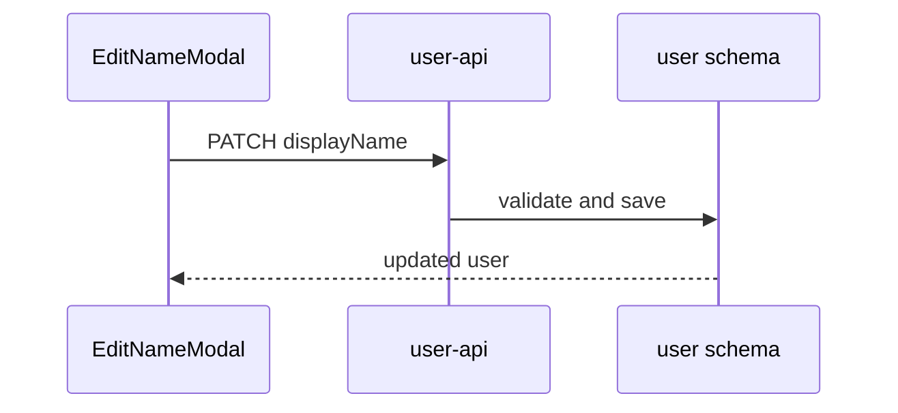

# Plan diagrams (`--diagrams`)

Applies only when the developer passed `--diagrams`. Otherwise do none of this.

## Where they go

Add one `## Diagrams` section **between `## Requirements` and `## Tasks`**. Never after `## Tasks`: later skills parse everything under `## Tasks` as tasks, so anything after it risks being read as one.

Inside it, one `### <title>` per diagram, each with a one-line caption saying what it shows, then a fenced `mermaid` block.

````markdown
## Diagrams

### Update display name flow
How an edit travels from the modal to the database.


````

## Which diagram

Pick only those that clarify this story, usually one or two. Skip the section entirely when none would say more than the requirements already do.

- **sequenceDiagram**: the story crosses layers (UI, API, database, external service).
- **erDiagram or classDiagram**: the story adds or changes a schema or model.
- **stateDiagram-v2**: the story has statuses or a multi-step flow.
- **flowchart**: the story has branching or validation rules.
- **flowchart (task map)**: three or more tasks touch each other's files. Nodes are tasks or files, edges show "uses" or "feeds".

## Rules

- Every node is a real requirement, task, file or component found in Phase 2 or the Figma design. Never invent one to fill out a diagram.
- Use the same names as the tasks (`EditNameModal`, `validateDisplayName`) so a reader can match diagram to task.
- Show only what this story creates or changes. Mark unchanged neighbours as context, not detail.
- Keep each diagram under about 12 nodes. Split it if it grows past that.
- Quote any label containing spaces or special characters, such as `A["@src/account/api.js"]`. Avoid `@`, parentheses and colons in unquoted labels. Unquoted ones break rendering.
- Do not annotate order or parallelism (for example "step 1", "runs in parallel"). That belongs to `analyze-task-dependencies`.
- The diagrams explain the plan. They never replace a requirement or a task. Anything an implementer must do still appears as a task.
